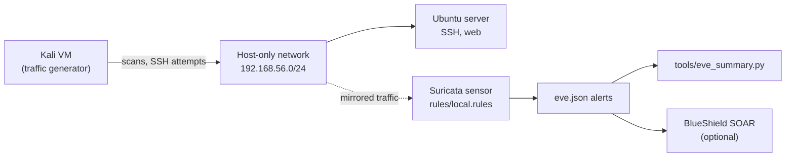

# Suricata IDS Lab

A network intrusion detection lab built with **Suricata**. It has custom detection rules for
reconnaissance, brute force and risky network policy violations, an offline test harness that
proves the rules fire, and a small tool that turns raw `eve.json` alerts into an analyst-friendly
summary.

## Lab network



## Detection rules

| SID | Detects | ATT&CK | Verified |
|---|---|---|---|
| 1000001 | TCP SYN port scan (20+ SYNs from one source in 10 s) | T1046 | ✅ fires on test pcap |
| 1000002 | TCP NULL scan | T1046 | ✅ fires on test pcap |
| 1000003 | TCP XMAS scan | T1046 | ✅ fires on test pcap |
| 1000004 | ICMP ping sweep (10+ echo requests in 5 s) | T1018 | ✅ fires on test pcap |
| 1000010 | SSH brute force (6+ new connections in 60 s) | T1110 | ✅ fires on test pcap |
| 1000011 | Cleartext FTP password | T1552 | ⚙️ loads; needs a live FTP session to test |
| 1000020 | Telnet connection to an internal host | T1021 | ✅ fires on test pcap |
| 1000030 | DNS query to a commonly abused TLD (.zip, .top, .xyz…) | T1071.004 | ✅ fires on test pcap |
| 1000040 | Outbound HTTP with a PowerShell / curl / wget User-Agent | T1105 | ⚙️ loads; needs a live HTTP session to test |

All rules pass `suricata -T` on Suricata 7.0.3.

## Quick test (no lab needed)

```bash
pip install scapy
python3 tools/generate_test_pcap.py                 # writes lab.pcap
# set HOME_NET: "[192.168.56.0/24]" in your suricata.yaml, then:
suricata -c /etc/suricata/suricata.yaml -S rules/local.rules -r lab.pcap -l out/ -k none
python3 tools/eve_summary.py out/eve.json
```

Example output:

```
Suricata alert summary: 7 alerts

By signature (most severe first):
  [sev 1]    1  LAB CRED Possible SSH brute force
  [sev 2]    1  LAB RECON Possible TCP SYN port scan
  ...
By source IP:
  10.0.0.66          5 alerts  ->  LAB RECON ICMP ping sweep; LAB RECON Possible TCP SYN port scan; ...
```

## Full lab setup

See [`docs/setup.md`](docs/setup.md) for running Suricata live on a lab network and generating
traffic from Kali.

## Repository layout

```
suricata-ids-lab/
├── rules/local.rules            # custom Suricata rules (SIDs 1000001+)
├── tools/eve_summary.py         # eve.json -> triage summary (text or JSON)
├── tools/generate_test_pcap.py  # offline test traffic
├── tests/                       # pytest tests + sample alerts
└── docs/setup.md
```

## Roadmap

- [x] Recon, brute-force and policy rules, validated with `suricata -T`
- [x] Offline pcap test harness and alert summariser
- [ ] Live-lab screenshots of each alert
- [ ] Test the FTP and HTTP rules with real sessions
- [ ] Forward alerts to [BlueShield](https://github.com/Pzycokid/blueshield) for enrichment

## Author

**Likhith H S**, M.Sc. Cyber Security, NFSU Goa · CEH · CCNA ·
[LinkedIn](https://www.linkedin.com/in/LikhithHS15)
